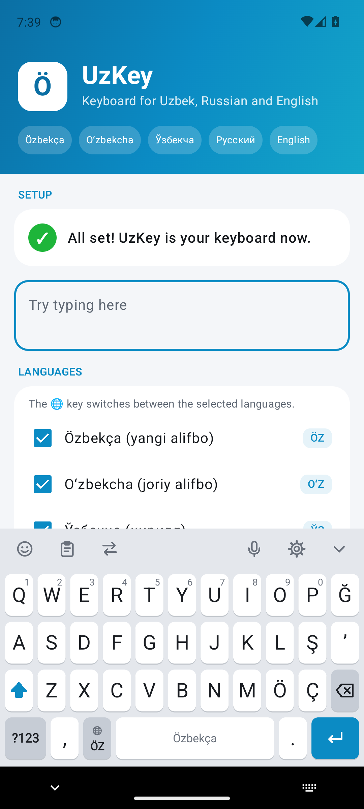
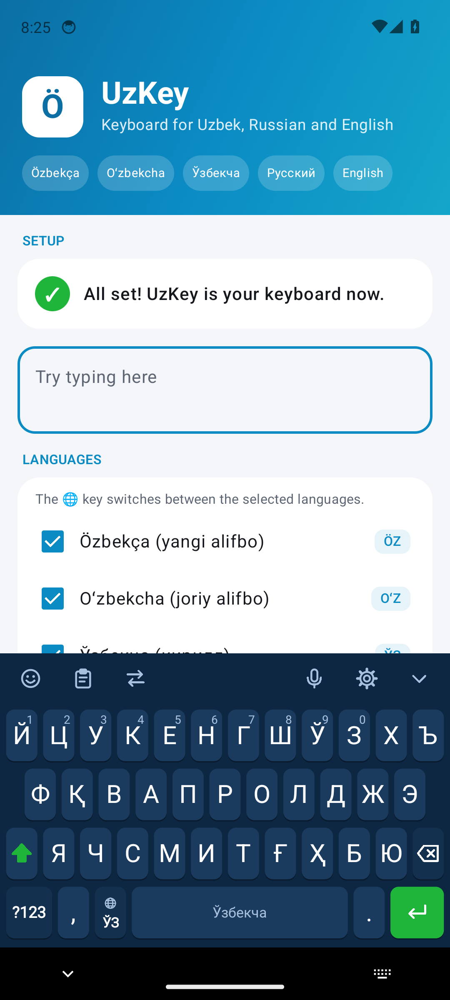
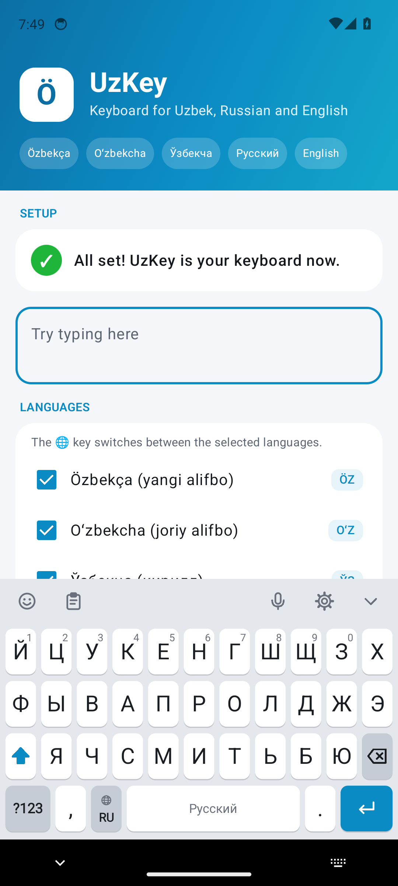
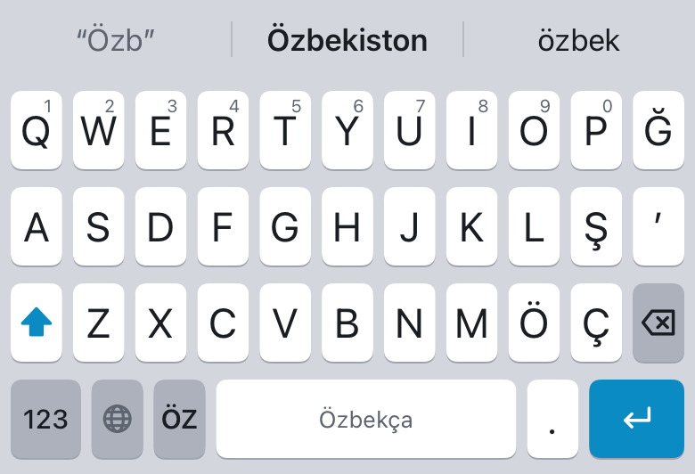
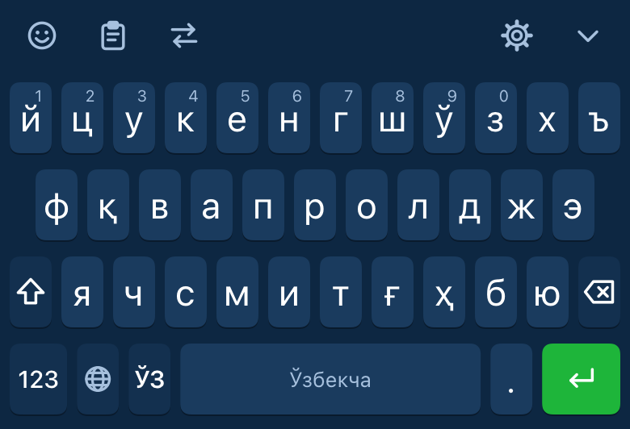
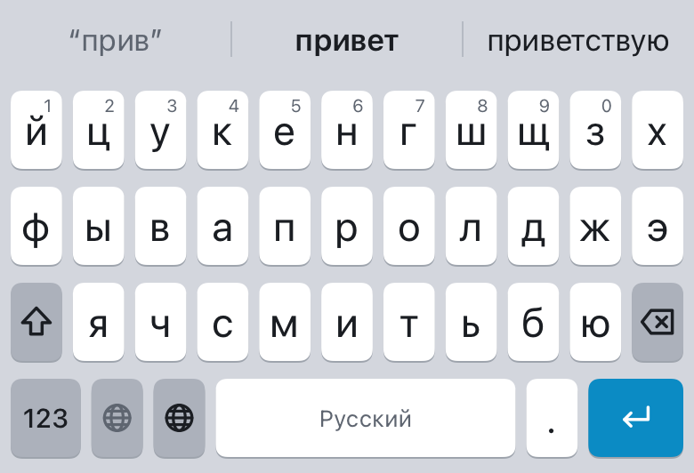

# UzKey — Özbek klaviaturasi (Android + iOS)

Yangi özbek alifbosi (2027), joriy lotin alifbosi, kirill, rus va ingliz tillarida yozish uçun klaviatura.
Android (Kotlin) va iOS (Swift) uçun alohida native ilova, tugmalar joylaşuvi va luğatlar `shared/` papkasida umumiy.

## Imkoniyatlar

| | |
|---|---|
| **Tillar** | Özbekça (yangi alifbo: ö ğ ş ç ʼ), Oʻzbekcha (oʻ gʻ), Ўзбекча, Русский, English — 🌐 tugmasi bilan almaştiriladi |
| **Söz takliflari** | Davomini taklif qiliş, xatoni tuzatiş (kiotb → kitob), keyingi sözni bashorat qiliş |
| **Örganiş** | Siz yozgan söz va ismlarni eslab qoladi (faqat telefonda) |
| **Eski yozuvni qabul qiliş** | Yangi alifboda `yaxsh` yozsangiz `yaxşi` taklif qilinadi; `o'` → `ö`, `g'` → `ğ` avtomatik |
| **Alifbo ögirgiç (⇄)** | Matnni kirill ↔ lotin ↔ yangi lotin alifbosiga bir tugma bilan ögiradi |
| **Tugmalar** | Bosib turganda qöşimça harflar (o → ö, oʻ, ó…), raqam belgilari, Caps Lock (Shift ×2), böş joyni surib kursorni siljitiş |
| **Qulayliklar** | Ikki böş joy → nuqta, avtomatik boş harf, emoji paneli (700+), raqam/telefon maydonlari uçun raqamli klaviatura |
| **Surib yoziş** | Barmoqni kötarmasdan harflar ustida surib söz yoziş (5 ta tilning hammasida) |
| **Bufer tarixi** | Oxirgi nusxa olingan matnlar (24 soat, muhimlarini saqlab qöyiş mumkin; parollar saqlanmaydi) |
| **Ovoz bilan yoziş** | Android: 🎤 tugmasi Google ovozli yozişiga ötadi; iOS: tizimning diktovka tugmasi (klaviatura ostida) |
| **Maxsus imkoniyatlar** | TalkBack va VoiceOver: har bir tugma övozli öqiladi, barmoqni kötarib yoziş |
| **Ekranlar** | Telefon, planşet, yotiq holat uçun alohida ölçamlar |
| **Dizayn** | 5 ta mavzu (Tizim, Yoruğ, Qoronği, Qora AMOLED, Moviy), 3 xil tugma balandligi |
| **Maxfiylik** | Android ilovada internet ruxsati umuman yöq; iOS da hech narsa tarmoqqa yuborilmaydi |

## Skrinşotlar

CI har safar klaviaturani haqiqiy Android emulyatorida va iOS da çizib, rasmlarni `docs/screenshots/` ga saqlaydi.

| Özbekça (yangi alifbo) | Ўзбекча | Русский |
|---|---|---|
|  |  |  |
|  |  |  |

## Örnatiş

### Android
1. GitHub → **Actions** → oxirgi muvaffaqiyatli **Android** işga tuşirilişi → `uzkey-android` artefaktini yuklab oling.
2. `apk/release/app-release.apk` ni telefonga örnating (nomaʼlum manbalardan örnatişga ruxsat bering).
   Google Play uçun esa `bundle/release/app-release.aab` yuklanadi.
3. UzKey ilovasini oçing → **Yoqiş** → **Tanlaş**.

Özingiz yiğiş uçun (JDK 17 va Android SDK kerak):
```bash
cd android
./gradlew assembleRelease        # APK: app/build/outputs/apk/release/
./gradlew testDebugUnitTest      # unit testlar
```
Haqiqiy reliz kaliti bilan imzolaş uçun `UZKEY_KEYSTORE_PATH`, `UZKEY_KEYSTORE_PASSWORD`, `UZKEY_KEY_ALIAS`,
`UZKEY_KEY_PASSWORD` muhit özgaruvçilarini (CI da — xuddi şu nomdagi secret'lar va `UZKEY_KEYSTORE_BASE64`) bering.
Aks holda reliz APK debug kaliti bilan imzolanadi va Play'ga yuklab bo'lmaydi.
Kalitni bir buyruq bilan yasaş (çiqqan qiymatlarni GitHub → Settings → Secrets → Actions ga qöşing):
```bash
tools/release/create_android_keystore.sh uzkey-release.jks "CN=Ismingiz, O=Taşkilot, C=UZ"
```
`versionCode` CI da işga tuşiriliş raqamidan olinadi (yoki `UZKEY_VERSION_CODE` bilan beriladi).

### iOS
iPhone ga örnatiş uçun Apple hisobi bilan imzolaş şart:
```bash
brew install xcodegen
cd ios
xcodegen generate
open UzKey.xcodeproj
```
1. Xcode da **UzKey** va **UzKeyKeyboard** targetlari uçun **Signing & Capabilities** → Team ni tanlang.
   Bundle ID lar (`uz.uzkey.app`, `uz.uzkey.app.keyboard`) va App Group (`group.uz.uzkey.keyboard`) ni özingiznikiga
   almaştiring (App Group ni `Shared/KeyboardSettings.swift` da ham yangilang).
2. iPhone ni ulab **Run** bosing.
3. Sozlamalar → UzKey → Klaviaturalar → **UzKey** ni yoqing (tebraniş uçun «Töliq ruxsat» ni ham yoqing).

CI imzolanmagan `UzKey-unsigned.ipa` ni ham yasaydi — uni Sideloadly/AltStore orqali özingizning Apple ID ingiz bilan imzolab örnatiş mumkin.

## Testlar

| | Nima tekşiriladi | Qayerda |
|---|---|---|
| Android unit | takliflar, transliteratsiya, tugmalar, surib yoziş, haqiqiy luğatlar sifati va tezligi | `./gradlew testDebugUnitTest` |
| Android UI | haqiqiy klaviatura emulyatorda: yoziş, Shift/Caps Lock, takliflar, til almaştiriş, belgilar, raqamli klaviatura, parol maydonida örganmaslik, alifbo ögirgiç, surib yoziş | CI: `tools/ci/android_ui_tests.sh` |
| iOS unit | yadro mantiq, skrinşotlar, luğat xotirasi, takliflar tezligi | `xcodebuild test` (CI) |

Bularning hammasi har bir push'da CI da işlaydi.

## Reliz

- Maxfiylik siyosati: [PRIVACY.md](PRIVACY.md) (özbekça, rusça, inglizça)
- Do'kon matnlari va talablari: [docs/store/listing.md](docs/store/listing.md)
- iOS ilova va kengaytmada Apple talab qilgan `PrivacyInfo.xcprivacy` bor; CI IPA ni tekşiradi.

## Tuzilma

```
shared/            umumiy maʼlumotlar (ikkala ilova ham şundan foydalanadi)
  layouts/*.json   tugmalar joylaşuvi (til, belgilar, raqamlar)
  dictionaries/    söz chastotalari luğatlari
  emoji.json       emoji toifalari
tools/             luğatlarni yasaş skripti va özbekça söz bazasi
android/           Kotlin: InputMethodService + Jetpack Compose sozlamalar
ios/               Swift: Keyboard Extension + SwiftUI sozlamalar (XcodeGen)
```

Luğatlarni qayta yasaş:
```bash
pip install wordfreq
python3 tools/build_dictionaries.py
```
Özbekça luğatlar (50 000 söz) yangiliklar korpusi (~120 mln söz) va özbek Vikipediyasidan sanalgan chastotalar
(`tools/uz_corpus_freq.tsv`, uni **Uzbek dictionary** CI jobi `tools/build_uz_corpus.py` bilan yasaydi) va
`tools/uz_seed.txt` dan joriy lotin yozuvida tuziladi; skript ulardan yangi alifbo va kirill luğatlarini avtomatik yasaydi.

Litsenziyalar uçun [NOTICE.md](NOTICE.md) ga qarang.
